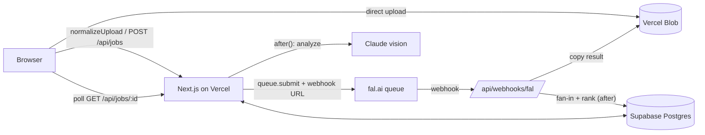

# Character Swap

Upload a photo of someone doing something, add one to four photos of yourself, and get the same moment back with you in it.
Your face, age, gender and build come from your photos; the pose, action, held objects, camera, light and scene come from the template.
Three steps: **Template → Your photos → Result.** Photo only.

**Live:** TODO(real run): production URL. The access code is in the email.

> Lines marked `TODO(real run)` need data from real (non-mock) runs and are filled in by hand or by `npm run report -- --write`. Nothing here is estimated or made up.

## Run locally

Needs Node 22 (any Node ≥ 20.9 works) and a Postgres database. The project uses a hosted Supabase project in dev and prod, but any Postgres 16 works (CI uses the `postgres:16` image).

```bash
cp .env.example .env.local      # set DATABASE_URL (and DIRECT_URL for Supabase's session pooler); leave the rest empty
npm i                           # also fetches the face models into /models and /public/models/mediapipe
npm run db:migrate && npm run db:seed
npm run dev                     # http://localhost:3000, access code "dev-access"
```

With only `DATABASE_URL` set, everything else runs on mocks: generation (`lib/fal/mock.ts`), template analysis (`lib/ai/mock.ts`), storage (`public/uploads`), and the face engine if the models are missing.

**Real providers locally:** set `FAL_KEY`, `ANTHROPIC_API_KEY` and `BLOB_READ_WRITE_TOKEN`. fal has to reach the webhook, so start a tunnel (`cloudflared tunnel --url http://localhost:3000`) and set `APP_URL` to the tunnel URL.

**Tests:** `npm test` (Vitest, in-memory PGlite), and `npm run test:e2e` (Playwright on Mobile Safari, Desktop Chrome and Desktop Safari). First run `npx playwright install`. The e2e suite needs `DATABASE_URL` with migrations applied. It forces every mock, whatever `.env.local` holds, and deletes the rows it created when it finishes.

## Deploy

1. Create a Vercel project from this repo (Node.js runtime; nothing else to configure).
2. Set every variable in [`.env.example`](.env.example). In production the app refuses to start without `SESSION_SECRET`, `ACCESS_CODE`, `APP_URL`, `WEBHOOK_SECRET`, `CRON_SECRET`, `FAL_KEY`, `ANTHROPIC_API_KEY` and `BLOB_READ_WRITE_TOKEN`.
3. `DATABASE_URL` = the Supabase **transaction pooler** (port 6543, `?sslmode=require`); `DIRECT_URL` = the session pooler (port 5432) for migrations. Run `npm run db:migrate` against it.
4. `APP_URL` = the production URL (fal's webhooks are built from it).
5. Connect a Vercel Blob store to the project (this sets `BLOB_READ_WRITE_TOKEN`).
6. Check the cron is registered: Project → Settings → Cron Jobs shows `/api/cron/cleanup` daily at 04:00 UTC ([`vercel.json`](vercel.json)). Vercel sends `CRON_SECRET` as the bearer token.
7. `GLOBAL_DAILY_UNITS`: run `npm run report -- --budget-usd <daily budget>` against real data and use the suggested value.
8. Top up fal and Anthropic credit for the 7 days: `expected rounds per day × cost per round × 7 × 2` (safety factor). The cost per round is in the metrics block below.

## Architecture

- The browser uploads photos straight to Vercel Blob. Phone photos never pass through a function body.
- `normalizeUpload` turns each photo into a JPEG (EXIF rotation, HEIC) and runs the face checks. `POST /api/jobs` creates the job and returns at once.
- Everything slow runs after the response (`after()`) or on fal. Claude reads the template. fal's queue generates one image on the case's best generator and calls a webhook when it is done.
- The webhook copies the result into Blob, finishes the round and scores its likeness.
- The browser polls `GET /api/jobs/:id` every 2.5 s. A daily cron times out stuck jobs and deletes data past retention.



## Identity rule

**The user wins on who they are, the template wins on what is happening.** If the template shows a woman and the user is a man, the result is the man in the same pose, place and light. The same goes for adult and child. Clothing keeps the template's style but is fitted to the user's body. Hairstyle comes from the user.

Exceptions found in acceptance runs:

- TODO(real run): each exception, with the reason (for example a held object sized for the template's body, or a safety filter overriding the rule).

## Models and why

| Job | Model | Why |
| --- | --- | --- |
| Generation (1 image per round) | `GENERATOR_BY_CASE` in [`lib/fal/models.ts`](lib/fal/models.ts): nano-banana-pro for case 1, seedream 4.5 for cases 2 and 3 | Chosen per case by the bake-off, see [0001](docs/decisions/0001-generator.md) |
| Fix the face | `fal-ai/face-swap` (`REFINE_MODEL`) | Puts the reference photo's face on the chosen result and leaves the rest of the picture alone |
| Template analysis | Claude (`claude-opus-5-5`, low effort) | Names the subject, action, held objects and the cross-gender or cross-age case for the prompt. Also rates how well each version keeps the action when likeness ties |
| Likeness scoring | InsightFace `buffalo_s` (SCRFD-500M + MobileFaceNet ArcFace) on `onnxruntime-node` | Small enough to run inside a Vercel function, with a 512-d embedding that is good enough to rank versions |
| Live photo check | MediaPipe FaceDetector in the browser | Tells the user about a missing or extra face before the upload finishes. The server check decides |

<!-- BAKEOFF:START -->
TODO(real run): paste `bakeoff/out/summary.md` here after `npm run bakeoff`.
<!-- BAKEOFF:END -->

**Dropped:** TODO(real run): one image per dropped generator, from [`docs/decisions/0001-generator.md`](docs/decisions/0001-generator.md).

**Why not video:** hosted video models limit clip length, so a longer clip means stitching chunks, and the face drifts from one chunk to the next. Holding identity is the whole point of the product, so it ships photo only.

## Measured cost and time

<!-- METRICS:START -->
<!-- METRICS:END -->

Filled by `npm run report -- --write` from real `provider_calls` and `job_rounds` rows (mock rows are excluded).

**fal billing reconciliation:** TODO(real run): sum of `provider_calls.cost_usd_micros` for fal over a date range vs. the fal dashboard's usage for the same range.

## Where it fails

Each mode has an image pair in [`docs/failures/`](docs/failures/README.md). The counts are from the acceptance runs (n of N attempts).

### Adult ↔ child
TODO(real run): what happened · how often (n/N) · why · what the app does.

### Held objects
TODO(real run): what happened · how often (n/N) · why · what the app does.

### Backlighting
TODO(real run): what happened · how often (n/N) · why · what the app does.

### Skin-tone drift
TODO(real run): what happened · how often (n/N) · why · what the app does.

### Occlusion (sunglasses, hands, hair)
TODO(real run): what happened · how often (n/N) · why · what the app does.

### Multiple people
TODO(real run): what happened · how often (n/N) · why. What the app does: picks one subject in the template, outlines it on the result screen and names it in a notice.

### Waxy face after Fix the face
TODO(real run): what happened · how often (n/N) · why. What the app does: shows likeness before and after the fix, recommends keeping the original when likeness dropped, and lets the user choose.

### Child photos and safety filters
TODO(real run): what happened · how often (n/N) · why. What the app does: a content refusal is not retried, and the job ends with a clear message.

## Optional features and why

- **Photo guidance and live check:** most bad results come from bad input photos. Advice before upload and an instant face check in the browser catch those cheaply.
- **One image per round, on the best model for the case:** the template analysis decides the case (man to man, man to woman, woman to man, adult to child, child to adult) and `GENERATOR_BY_CASE` picks the generator that scored best on it in the bake-off.
- **Try again:** one new version with a new seed. Earlier versions stay in the strip, which appears once there are two.
- **Fix the face:** face-swap on the chosen version, with a before/after slider. Likeness before → after: TODO(real run): mean identity score change.
- **Share:** sends the picture itself through the system share sheet where the browser supports it, and copies its link otherwise.

## Engineering notes

- **No request runs inference.** Route handlers and actions return in under a second, and generation and Claude calls run in `after()` or on fal. The one exception is `normalizeUpload`: CPU face detection and embedding (under 1.5 s) run inside the action, so a photo that won't work is rejected while the user is still on that step. Ranking runs in `after()` of the last webhook.
- **Webhooks:** each fal attempt gets its own URL with an HMAC token over `candidate id:attempt`, checked before the body is read. `webhook_events` is unique on `(provider, request_id, status)`, so a replay is acknowledged and dropped. Candidate writes are conditional on `(id, attempt, status = 'pending')`.
- **Atomic fan-in:** the round moves on only through a conditional `running → …` update on `job_rounds`, so exactly one webhook advances the job however many arrive at once.
- **Timeouts and retries:** a job has 6 minutes. The limit is applied lazily on read and by the daily cron. A provider error is retried once with a new seed. A content refusal is not retried. A Fix the face round that runs out of time returns the original picture with a notice.
- **Rate limits:** one `job_rounds` row is one unit. A session gets 20 a day and the whole app gets `GLOBAL_DAILY_UNITS`. Both are counted in Postgres under an advisory lock, so two requests can't both take the last unit.
- **Retention:** uploads and results are deleted after `RETENTION_DAYS` (default 10). Uploads no job uses are deleted after 24 hours.
- **Images:** results are served through `next/image` with `sizes`, so phones download a thumbnail-sized copy. Each stored image is transformed once per width and then cached. Check the Vercel image-optimization usage against the plan's quota after the first days of grading.
- **InsightFace licence:** the code is MIT, but the pretrained `buffalo_s` weights are for non-commercial research use only. They're fine for this take-home. A commercial launch needs a licence from InsightFace or a differently licensed face model behind `lib/face/`.
