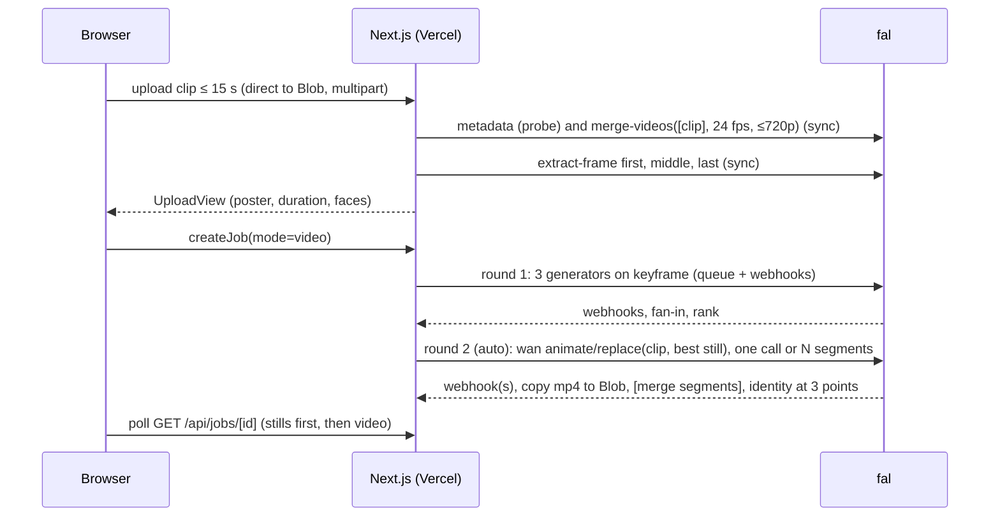

# 0002: Video character swap architecture

Status: **implemented behind `VIDEO_ENABLED` (default off)**, 2026-10-23. Clips up to **15 seconds** are a product
requirement. Phase 0 (the paid video bake-off) has not run yet, so open questions 1, 2 and 4–7 are still open.
"As built" notes below mark where the code differs from the first draft of this record.

## Context

Today a user gives one template **photo** and 1–4 photos of themselves and gets back a still with themselves in it. The
video track takes a template **clip of up to 15 seconds** instead (someone jumping off a pier, swinging a racket) and
returns that clip with the user in it. The two rules don't change: **identity** comes from the user, **action** (motion,
camera, scene, light) comes from the template.

The spec dropped video for two reasons: hosted clip-length limits and identity drift across stitched chunks. Fifteen
seconds is long enough that both have to be designed for, not assumed away:

- **Length:** fal documents no maximum duration for the replace model. Wan 2.2 Animate works internally in sliding
  windows of about 81 frames, so a 15 s clip is probably several windows inside a single call. The design runs the whole
  clip as **one call** by default and keeps a **segmented path** ready in case Phase 0 finds a hard cap or a quality
  cliff (§4).
- **Drift:** every window, or segment, is driven by the same likeness-ranked still (§1). The result's identity is
  measured at several points in the clip, not just one (§7), so drift shows up as a number.

Everything the photo track relies on stays in place: the fal queue and per-candidate webhooks, the round and candidate
fan-in, conditional writes guarded by the current round, the browser polling `GET /api/jobs/[id]`, rate-limit units and
the cleanup cron. Video is a new **round kind** on the same machinery, not a parallel system.

## Decision

### 1. Keyframe first, then animate

A video job runs as two chained rounds in one job:

1. **Generation round** (the existing one, unchanged) runs on a **keyframe** taken from the template clip. The output
   is the usual three ranked stills of the user in the template's pose.
2. **Animation round** (new `round_kind = 'animation'`) sends the top-ranked still plus the normalized clip to a video
   character-replacement model. The output is one video.

Why not send the selfie straight to the video model: the replace model takes **one** character image (`image_url`). A
selfie carries no body, outfit or pose, and it carries none of the cross-gender or cross-age handling that `cases.ts` and
`prompt.ts` already do. The ranked still already solves those problems, and it was picked on ArcFace likeness. It is the
best single image we can give the video model. It also gives the user something to look at while a 15 s clip renders.

The user can then **Animate another version**: start an animation round from any other succeeded still. This mirrors
Fix the face, which starts a refinement round from a chosen candidate.



### 2. Models

Ids live only in `lib/fal/models.ts`, as they do today.

| Role | Endpoint | Notes |
| --- | --- | --- |
| Video generator | `fal-ai/wan/v2.2-14b/animate/replace` | inputs `video_url`, `image_url`, `resolution` (480p/580p/720p), `seed`, `num_inference_steps`, `enable_output_safety_checker`; output `{ video: { url } }`. $0.04 / $0.06 / $0.08 per video second at 480p / 580p / 720p, where a video second is **16 frames**. No documented maximum duration. |
| Probe | `fal-ai/ffmpeg-api/metadata` | `media_url` returns `{ media: Video }` with `duration` (s), `fps`, `frame_count` and `resolution.{width,height}`, per the endpoint types published in `@fal-ai/client`. $0. |
| Clip normalization, and the segment join | `fal-ai/ffmpeg-api/merge-videos` | `video_urls[]`, `target_fps` (1–60), `resolution`; output `{ video }`. A one-item list re-encodes a single clip, which is how we normalize. $0 listed. |
| Keyframe and identity frames | `fal-ai/ffmpeg-api/extract-frame` | `video_url`, `frame_type` ∈ first, middle, last; returns `images[].url`. About $0.0002/s. |

Using fal's ffmpeg endpoints means **no ffmpeg binary on Vercel**: there's no bundle-size hit and no native dependency,
and `lib/fal/client.ts` stays the only module that talks to fal. The default resolution is 580p. A video bake-off (see
Rollout) decides the final value.

### 3. Clip normalization: frame rate is the cost lever

fal bills **frames ÷ 16**, so a 15 s clip costs very different amounts depending on its frame rate:

| Source clip, 15 s | Frames | Billed s | 580p | 720p |
| --- | --- | --- | --- | --- |
| 60 fps (iPhone default for many users) | 900 | 56.3 | $3.38 | $4.50 |
| 30 fps | 450 | 28.1 | $1.69 | $2.25 |
| **24 fps (normalized)** | **360** | **22.5** | **$1.35** | **$1.80** |

Every clip is therefore **normalized at upload**: `merge-videos([raw], target_fps: VIDEO_TARGET_FPS, resolution: ≤720p long edge)`.
The result is copied into our Blob store as the upload's `video_url`, and the raw clip is deleted. This is the same rule
photos follow (raw is deleted after normalizing), and it means:

- cost is bounded by **duration alone**: at most `15 × 24 = 360` frames, whatever the phone recorded;
- the replace model always gets a modest, predictable input (smaller downloads, faster renders);
- our stored copy is small: about 5–10 MB for 15 s at 720p, against the raw upload's 100+ MB.

Duration comes from the metadata probe. A probe without a duration means we can't read the clip: `VIDEO_DECODE_FAILED`.
(As built: the in-process `mvhd` fallback of the first draft isn't needed, because fal's published types guarantee the field.)

### 4. One call by default, segments as a ready fallback

**Default (`VIDEO_SEGMENT_SECONDS = null`):** the animation round has **one** candidate covering the whole clip.

**Fallback (`VIDEO_SEGMENT_SECONDS = 5`, for example):** turned on only if Phase 0 shows the replace model rejects 15 s
or degrades past some length.

- The animation round gets **N candidates**, one per segment (`candidates.segment_index` = 0…N-1), all with the same
  driving still and the **same seed**.
- They fan in through the existing `maybeFinishRound` logic: every candidate finished means the round can advance.
- One segment failure is retried automatically (`MAX_AUTO_RETRIES`). If it still fails, the whole animation fails,
  because a video with a hole isn't shippable.
- Segments overlap by `VIDEO_SEGMENT_OVERLAP_FRAMES` (8) and are joined with `merge-videos`. The join is the one extra
  step this path adds.
- Cutting the segments needs a trim step. fal's ffmpeg set as checked doesn't include one, so **Phase 0 must confirm a
  trim endpoint** (or `merge-videos` with in/out points). If none exists, this fallback runs `ffmpeg-static` in the
  normalize function only.

This keeps the risky part of the spec's objection ("stitched chunks") behind a switch, and the data model supports it
from the first migration, so turning it on needs no schema change.

As built: only the whole-clip path is implemented. `candidates.segment_index` exists, and the `VIDEO_SEGMENT_*` constants
and the segment fan-in wait for Phase 0 to show they're needed.

### 5. Limits (all new constants go in `lib/limits.ts`)

| Constant | Value | Why |
| --- | --- | --- |
| `MAX_VIDEO_SECONDS` | **15** | Product requirement. Checked on the probe's duration. |
| `VIDEO_DURATION_TOLERANCE_MS` | 250 | Container rounding: a 15.2 s probe still passes. |
| `VIDEO_TARGET_FPS` | 24 | §3: bounds cost and render time and looks smooth on a phone. At most 360 billed frames. |
| `VIDEO_MAX_LONG_EDGE` | 1280 | 720p class. The model renders at most 720p, so more is wasted bytes. |
| `MAX_VIDEO_UPLOAD_BYTES` | 200 MB | Covers a 15 s 4K60 HEVC phone clip. Blob client uploads use multipart above about 100 MB. `MAX_UPLOAD_BYTES` (25 MB) stays for photos. |
| `MAX_RESULT_VIDEO_BYTES` | 60 MB | Cap for `fetchObject` when copying a normalized clip or a result mp4. The photo cap stays at 25 MB. |
| `ACCEPTED_VIDEO_MIME` / `_EXT` | mp4, mov (QuickTime), webm, m4v | What the replace model and the ffmpeg endpoints accept. |
| `VIDEO_UTILITY_TIMEOUT_MS` | 60 s | Per synchronous ffmpeg call in the normalize action. The create page's `maxDuration` is 120 s. |
| `ANIMATION_TIMEOUT_MS` | 25 min | A 15 s render is several windows. Tune it from Phase 0 timings. `JOB_TIMEOUT_MS` (6 min) stays for still rounds. |
| `ANIMATION_ROUND_UNITS` | 5 | At most $1.35 per animation at 580p against about $0.27 per still round. See §6. |
| `DEFAULT_ANIMATION_MS_PER_SECOND` | 20 000 | The ETA fallback, scaled by clip length (a 15 s clip shows about 5 min) until real samples exist. |
| `ANIMATION_RESOLUTION` | `'580p'` | §2. |
| `VIDEO_SEGMENT_SECONDS`, `VIDEO_SEGMENT_OVERLAP_FRAMES` | not added | §4: only once Phase 0 needs segments. |

A clip over 15 s is rejected with `VIDEO_TOO_LONG` ("Clips can be up to 15 seconds. Trim it on your phone and try
again."). Server-side trimming is out of v1. The browser reads `video.duration` before uploading and rejects early, but
that check is only advisory: the server's probe is what counts.

### 6. Data model (one Drizzle migration, all additive)

```text
uploads    + media_type   enum('image','video') not null default 'image'
           + video_url    text      -- the normalized clip (24 fps, ≤720p mp4); url stays = the keyframe JPEG
           + duration_ms  integer, fps real, frame_count integer   -- of the normalized clip
           + keyframe     text      -- 'first' | 'middle' | 'last'
jobs       + mode         enum('photo','video') not null default 'photo'
job_rounds + units        integer not null default 1   -- rate-limit weight of the round
candidates + video_url    text      -- our Blob copy of the mp4; image_url = the driving still (poster)
           + segment_index integer  -- null for whole-clip animation; 0…N-1 in segmented mode (§4)
enum round_kind + 'animation'
enum job_stage  + 'animating'
```

`upload_kind` keeps `'template'`, and `media_type` tells clip from photo. This keeps `createJob`'s checks unchanged.

`checkUnits` changes from `count(*)` to `sum(units)` over `job_rounds`. The rule "one row is one unit" becomes "one row
is `units` units", and every existing row stays at 1. `MAX_ROUNDS_PER_JOB` still counts rows.

`FAL_PRICES` gets a second price shape (`perVideoSecondUsdMicros`, keyed by resolution), and `falCostMicros` takes
`{ frames, resolution }` for the video model: `ceil(frames / 16) × price`. Costs stay integer micro-dollars.

### 7. Pipeline modules

| File | Change |
| --- | --- |
| `lib/fal/models.ts` | `VIDEO_MODEL`, `FFMPEG_METADATA`, `FFMPEG_MERGE`, `FFMPEG_EXTRACT_FRAME`. Add `buildAnimateInput({ videoUrl, imageUrl, seed, resolution })`, `parseVideoOutput`, and `parseFrameOutput`. `FalModel` widens. |
| `lib/fal/client.ts` | `runUtility(model, input, { timeoutMs })`: the one documented exception to "never sync in a request". Allowed for the ffmpeg endpoints only, with a hard timeout. Records a `provider_calls` row like `runSync`. `runVideoSync` is the script-only video call for the bake-off. |
| `lib/pipeline/rounds.ts` | **new**: `startRound` (with `units`) and `FIRST_STAGE`, moved out of `server/jobs/create.ts` so the orchestrator can open the animation round without `lib/` importing `server/`. |
| `lib/fal/mock.ts` | Mock video webhook returns `tests/fixtures/clip-2s.mp4`. Mock probe returns metadata for that fixture. Mock merge echoes its input. Mock extract-frame returns `face-one-grey.jpg`. |
| `lib/storage.ts` | `rawVideoPathnamePattern(sid)` (mp4, mov, webm, m4v). `fetchObject(url, { maxBytes })`. As built: video copies are buffered, not streamed. The normalized clip and results are about 5–10 MB, and `MAX_RESULT_VIDEO_BYTES` caps them. |
| `lib/pipeline/preprocess-video.ts` | **new.** Probe, check ≤ 15 s, normalize (§3), copy, delete the raw clip. Then extract three frames, run `faceEngine.analyzeImage` on each, keep the best subject frame as the keyframe, normalize it with `normalizeImage`, and insert one `uploads` row. More than one confident face on the keyframe: reject with `VIDEO_MULTIPLE_PEOPLE` in v1. |
| `lib/pipeline/animate.ts` | **new**, modeled on `refine.ts`: `runAnimationRound`, `submitAnimation(candidate)`, `settleAnimation(roundId)`. Whole-clip mode has one candidate. Segmented mode fans in all segments, then merges them. |
| `lib/pipeline/fan-in.ts` | `storeResult` branches on `candidate.kind === 'animation'`: it streams the mp4 to `results/<job>/<cand>.mp4` (no sharp), then routes to `settleAnimation`. Retry-with-new-seed works as-is; in segmented mode a retry keeps the shared seed. |
| `lib/pipeline/orchestrator.ts` | It loads `animate.ts` lazily, only for video jobs: that breaks the import cycle, and photo jobs never load it. `finishRound`: when `job.mode === 'video'` and the round was generation, it does **not** succeed the job. In the same transaction it opens the animation round (`startRound(kind: 'animation', units: ANIMATION_ROUND_UNITS)`), sets stage `animating`, and sets the deadline from `ANIMATION_TIMEOUT_MS`. Add `finishAnimation(jobId, roundId, outcome)`: if animation fails, the job still **succeeds** with its stills plus an `ANIMATION_FAILED` notice (the same pattern as `REFINEMENT_FAILED`). |
| `lib/pipeline/timeout.ts` | Uses the deadline for the round kind. An `animating` job past its deadline goes back to `succeeded` with `ANIMATION_FAILED`, as `refining` does. |
| `lib/pipeline/rank.ts` | Adds `scoreVideoIdentity(candidate)`: extract-frame at first, middle and last, run ArcFace against the reference, and store the **minimum** as `identity_score` (the frame where the face drifted furthest). The three per-frame scores go in `provider_calls.meta`. Shown, not used for gating. |
| `server/uploads/actions.ts` | `normalizeUpload` takes `kind: 'template', media: 'video'` and branches to `preprocess-video.ts`. The page calling it exports `maxDuration = 120`. |
| `app/api/blob/upload` | Per-request allowed types and size: video MIME types and `MAX_VIDEO_UPLOAD_BYTES` when the pathname matches the video pattern. `app/api/dev-upload` gets the same treatment. |
| `server/jobs/create.ts` | A video template sets `jobs.mode = 'video'`, and the deadline covers the still round only. Add `startAnimation(sid, { jobId, candidateId })` (Animate another version), modeled on `startRefinement`. `FIRST_STAGE.animation = 'animating'`. Both reject `mode: 'video'` when `VIDEO_ENABLED` is off. |
| `server/jobs/actions.ts` | `animateCandidate` action; schedules `runAnimationRound` in `after()`. |
| `server/jobs/view.ts` | `JobView.mode`, `template.videoUrl`, `template.durationMs`, `CandidateView.videoUrl`, `kind: 'animation'`, `canAnimate`. `etaMs` for an `animating` stage is the animation ETA × clip seconds. |
| `server/stats/queries.ts` | `computeAnimationMsPerSecond()`: the median of (round ms ÷ clip seconds) over recent succeeded animation rounds, with its own cache tag. |
| `app/api/jobs/[id]/download` | Serves `video/mp4` for animation candidates (buffered under `MAX_RESULT_VIDEO_BYTES`). |
| `server/cron/cleanup.ts` | Also deletes `uploads.video_url` and `candidates.video_url`. Raw clips use the same `sessions/<sid>/raw/` prefix, so the stale-raw sweep already covers them. |
| `lib/env.ts` | `VIDEO_ENABLED` (default `false`). The flag hides the video option in step 1 and rejects `mode: 'video'` server-side, so the photo app is untouched until it's switched on. |
| `lib/errors.ts` | `VIDEO_TOO_LONG`, `VIDEO_MULTIPLE_PEOPLE`, `VIDEO_DECODE_FAILED`, `VIDEO_UNAVAILABLE` (flag off). Notice `ANIMATION_FAILED`. |

The webhook route, token signing, event dedupe and the stale-attempt guard need **no change**: they key on candidate
id and attempt, not media type.

### 8. UI

- **Step 1, Template**: Dropzone accepts photo or clip (when the flag is on). A clip previews as a muted, looping
  `<video playsInline>` with the subject box drawn on the keyframe, plus its duration and a "up to 15 s" hint. Uploading
  shows progress (a 200 MB upload on mobile data takes a while), then "Preparing your clip…" during normalization.
  `stores/swap-flow.ts`'s `SlotState` gets `mediaType`.
- **Step 2, Your photos**: unchanged.
- **Step 3, Result**: a two-phase waiting screen ("Making your stills" → "Animating your 15 s clip, about 5 min"). The
  stills appear as soon as round 1 ranks, so the user isn't staring at a spinner for 5+ minutes. Then the video plays in
  `ResultView` (`<video controls playsInline loop muted>`, with the poster set to the still) next to the original clip.
  `CompareSlider` stays photo-only. Each still gets an "Animate this one" action. Download saves an `.mp4`; Share uses
  the Web Share API with the file when the browser supports it.

## Consequences

- **Cost per 15 s video job** at 580p is about $0.27 for three stills plus at most $1.35 for the animation: about **$1.62**
  (at 720p, $2.07). The daily cap still holds because animation rounds weigh `ANIMATION_ROUND_UNITS = 5`. With the
  default `SESSION_DAILY_UNITS = 20`, a session gets about 3 video jobs a day.
- **Latency**: about 1–3 min for stills, then several minutes for a 15 s clip. Polling at `POLL_INTERVAL_MS` is fine over
  that span. No websockets.
- **Identity drift** is the main quality risk at 15 s. Mitigations: one driving still for every window or segment, a shared
  seed, and the minimum-of-three identity score so drift is visible. The bake-off checks it at 5, 10 and 15 s.
- **Upload**: a 200 MB direct upload is the slowest part on mobile. The browser shows real progress, and the server never
  proxies the bytes.
- **Storage**: normalization keeps stored clips at about 5–10 MB, so retention costs stay close to photo levels. The raw
  clip is deleted right after normalizing.
- **Local dev**: fal can't fetch `localhost` uploads, so video runs **mock-only** without Blob, the same as photo
  generation.

## Open questions (resolve in Phase 0)

1. Does the replace model accept a 15 s, 360-frame input in one call, and how does quality hold from 0–5 s against
   10–15 s? This decides whether `VIDEO_SEGMENT_SECONDS` stays null.
2. Does `merge-videos` with a one-item list re-encode at `target_fps`? If it doesn't, find another fal ffmpeg endpoint that
   does, or use `ffmpeg-static` in the normalize function.
3. ~~Do the metadata or merge outputs include duration and fps?~~ Resolved: the metadata types include `duration`, `fps` and `frame_count`.
4. Does the output keep the source audio? If it doesn't, add a mux step back onto the normalized clip's track, or ship
   silent with a note.
5. With two people in the clip, which one does the replace model swap? This decides whether `VIDEO_MULTIPLE_PEOPLE` can
   relax to a notice.
6. Does the ranked still beat the raw reference selfie as `image_url`? Keep both paths in the bake-off script.
7. Render time for 15 s at 580p and 720p, to set `ANIMATION_TIMEOUT_MS` and `DEFAULT_ANIMATION_MS_PER_SECOND`.
8. Safety: turn `enable_output_safety_checker` on by default, since outputs are real people's faces in motion.

## Rollout

1. **Phase 0, video bake-off.** `npm run bakeoff:video` (`scripts/bakeoff-video.ts`, inputs in `bakeoff/video-pairs.json`, shape in `bakeoff/video-pairs.example.json`). Run it with 3–4 clips of **15 s** across the cases. Compare the
   still-driven input against the selfie-driven input and 580p against 720p, and record per-second identity, cost and
   render time. Answer open questions 1–7 and record the outcome in a revision of this ADR. Budget: about $15.
2. **Phase 1, data and upload.** Migration, limits, errors, `preprocess-video.ts`, upload routes, fal mocks, flag off.
3. **Phase 2, animation round.** `animate.ts` (whole-clip, plus segmented if Phase 0 requires it), orchestrator
   chaining, fan-in mp4 copy, timeouts, units, video identity, unit tests alongside the existing `retry-refine` and
   `webhook` tests.
4. **Phase 3, UI.** Step 1 clip support, two-phase waiting screen, video result, Animate this one, download and share.
5. **Phase 4, hardening.** e2e on the mock (clip upload → stills → video), cleanup coverage, cost report in
   `scripts/report.ts`, README update, flag on.

As built: phases 1–4 are in, with unit tests in `tests/video-swap.test.ts` and `tests/video-helpers.test.ts`, and the
README updated. Still to do: the Playwright e2e for a clip, video rows in `scripts/report.ts`, Phase 0 itself, and
switching the flag on.
